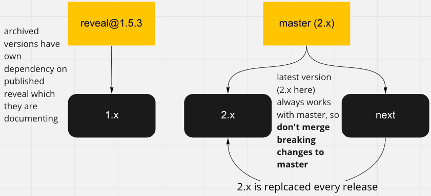

# Website

This [documentation website](https://cognitedata.github.io/reveal-docs/docs/) is built using [Docusaurus 2](https://v2.docusaurus.io/), a modern static website generator.

### Installation

```
$ yarn
```

### Local Development

```
$ yarn start
```

This command starts a local development server and open up a browser window. Most changes are reflected live without having to restart the server.

#### .env file

See `.env.example` to override project or model ids for local development. You need to copy it as `.env` file. It won't be commited.

### Build

```
$ yarn build
```

This command generates static content into the `build` directory and can be served using any static contents hosting service.

### Deployment

We deploy docs automatically for every merge into master. See workflows for details.

There are 2 repos where we host our docs:

* https://github.com/cognitedata/reveal-docs – for production documentation
* https://github.com/cognitedata/reveal-docs-preview - for PR previews

Also, reveal has own [gh-pages](https://github.com/cognitedata/reveal/settings/pages)
but it's merely has redirects [here](https://github.com/cognitedata/reveal/blob/gh-pages/index.html) and [there](https://github.com/cognitedata/reveal/blob/gh-pages/docs/index.html)
to reveal-docs, i.e.

`cognitedata.github.io/reveal/docs` → `cognitedata.github.io/reveal-docs`

### Versioning



We have several versions of our documentation for different reveal versions. We always have at least:

* `next` (`/docs` folder) – your main place to create documentation for new features. 
    Write docs well before release, and you won't need to edit other sections ever.
* `4.x` or latest (`/versioned_docs/version-4.x/` folder).
  On the website this is the default documentation section for users because it describes
  the latest reveal version that is published to NPM. Edit the latest version only when you want
  to apply some hotfix to documentation of the release that is already published.
  **You must also apply the same fix to `next` version**
  because `/versioned_docs/version-4.x/` is replaced by `next` on every release.
* `3.x` or other archived versions. They must be created on each major release.
  You need to edit those only when you want to clarify docs for older published reveal versions
  that are not actively maintained anymore.

We typically don't version minor versions. Instead, mark every new feature with comment like:

```
> **New in 4.1.0**
```

For API reference use `@version` tag in jsdoc. For example:

```js
/**
  * Sets transformation matrix of the model.
  * @param transformationMatrix
  * @version Added in 4.1.0
  */
```

Notice that `documentation/static` is not versioned, so if you remove something from there – double check that it's not used by other versions.

#### How to create new docs version?

Let's say you want to roll out new reveal@5.0.0, that's what needs to be done:

* create new 5.x section and make it default for docs website
* pin the reveal version used by the archived 4.x docs
* configure search

##### Create new 5.x section

[[Docusaurus versioning guide](https://docusaurus.io/docs/versioning)]
for the version of docusaurus you currently use, but basic usage is covered below.

Basically you need to copy the whole content of your `next` version under `versioned_docs` and version sidebars as well.
Run this command to do it:

```bash
yarn docusaurus docs:version 5.x
```

That will become default version for the docs website.

##### Pin the reveal version for the archived version

That step is needed because we are actually using reveal in docs, so docs are not just docs, but they have a dependency on reveal to show live demos.

Each folder under `versioned_docs/` is a yarn workspace with its own `package.json` (see `versioned_docs/version-4.x/package.json`).
Make sure the new version's `package.json` pins `@cognite/reveal` and `@cognite/sdk` to the versions it documents.

Also, at `src/plugins/remark-runnable-reveal-demo.js` add a new case to `getDocsPath` for the archived version, e.g.:

```js
case 'runnable-4x': return 'versioned_docs/version-4.x';
```

Then use the matching `runnable-4x` meta string in code blocks of that version's docs.

##### Configure search

[[Docusaurus guide on search](https://docusaurus.io/docs/search)]

If `algolia` is configured in `docusaurus.config.js`, adjust the `facetFilters` param by adding your new version.

That's pretty much all you need to do to create a new version of your docs.

##### Removing an old version

Delete `versioned_docs/version-X.x/` and `versioned_sidebars/version-X.x-sidebars.json`, remove the version from `versions.json`,
remove its case from `getDocsPath` in `src/plugins/remark-runnable-reveal-demo.js`, and run `yarn install` to refresh `yarn.lock`.
